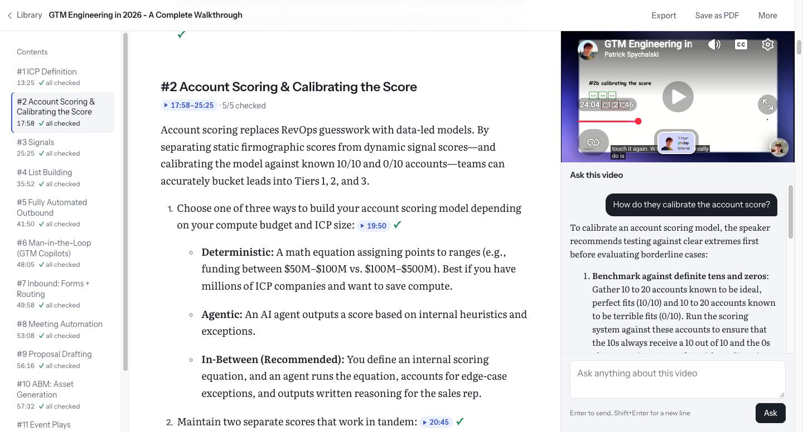
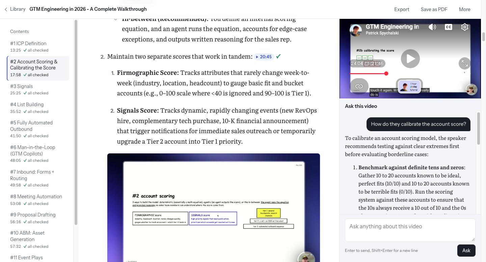
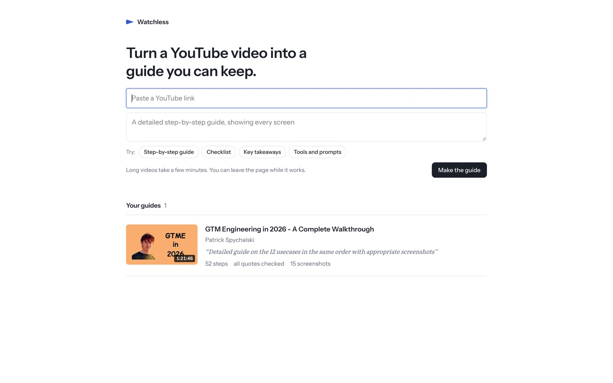
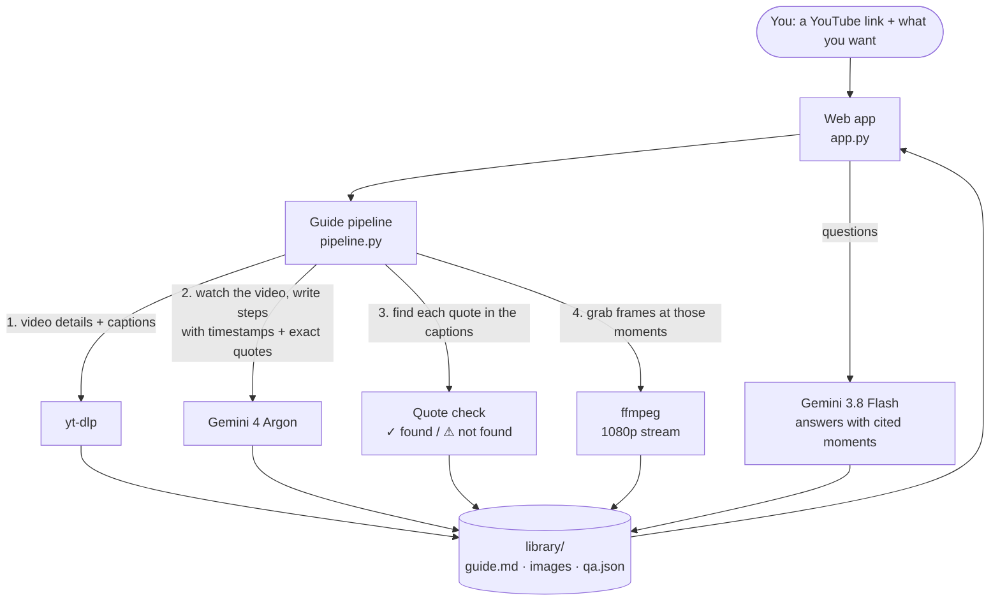

# Watchless

**Turn a YouTube video into a guide you can keep.** Paste a link, say what you want from it, and get a written guide with real screenshots from the video. Then ask the video questions.



## Why

Long tutorials and courses are worth keeping, not re-watching. Summaries made by AI are quick to read, but you can't tell which parts the video actually said and which the AI made up.

Watchless ties every step to the moment in the video it came from and checks it:

- Each step has a **timestamp** and the speaker's **exact words**.
- Those words are checked against the video's captions. **✓** means they were found; **⚠** means they weren't, and the step is flagged instead of hidden.
- Click any timestamp and the video plays at that moment, right next to the guide.

## What you can do

**Make a guide your way.** Ask for "a detailed step-by-step guide, showing every screen", "a checklist I can follow", "just the part about Clay", or anything else.

**See the actual screens.** Screenshots of the UI, slides and code are pulled from the right moments in sharp 1080p. Talking heads are skipped.



**Ask the video.** Answers come only from the video and cite the moments they're based on. Follow-up questions remember the conversation. Questions the video doesn't cover get "not covered" rather than a guess.

**Keep a library.** Every guide is saved on your computer. Add a guide from any link, make another guide from the same video with a different prompt, or remove ones you don't need.



**Take it with you.** Export a guide as Markdown with its images (zip), or save it as a PDF.

It handles videos from a few minutes to 3+ hours. A 3-hour course takes about 4 minutes.

## Quick start

You need [uv](https://docs.astral.sh/uv/getting-started/installation/), [ffmpeg](https://ffmpeg.org/download.html) (`brew install ffmpeg` on a Mac), [Node.js](https://nodejs.org/) or [Deno](https://deno.com/) (YouTube needs one to hand out video streams, or screenshots fail) and a [Gemini API key](https://aistudio.google.com/apikey).

```sh
git clone https://github.com/aravindsriraj/watchless.git
cd watchless
export GEMINI_API_KEY=your-key
uv run uvicorn app:app
```

Open **http://localhost:8000**, paste a YouTube link and press **Make the guide**.

Prefer the terminal?

```sh
uv run python pipeline.py "https://www.youtube.com/watch?v=..." "A checklist I can follow"
```

## How it works



1. **Read the video.** yt-dlp gets the title, length and English captions.
2. **Watch it.** Gemini watches the video straight from its YouTube link. It returns sections of steps, each with a timestamp and the speaker's exact words. Videos over 10 minutes use Gemini's long-video mode, which reads the transcript first and only looks closely at the parts that matter.
3. **Check it.** Each quote is fuzzy-matched against the captions within 90 seconds of its timestamp. A match marks the step ✓ and moves its timestamp to the exact second the words were said.
4. **Screenshot it.** ffmpeg pulls frames from YouTube's 1080p stream at each chosen moment, without downloading the video. It keeps the clearest frame from a 3-second window.

## Models and cost

You can change these at the top of `pipeline.py`.

| Job | Model | Why this one |
|---|---|---|
| Writing guides | `gemini-4-argon` | On a 3-hour course it wrote about 6× more detail than Flash: the exact commands, prompts and links |
| Answering questions | `gemini-3.8-flash` | Answers are short; it was just as accurate in testing, at about a third of the price |

Rough cost per guide at Argon's introductory price: **$0.25** for a 12-minute video, **$1.40** for a 3-hour one. Switching `GUIDE_MODEL` to Flash costs about a third as much, with less detail.

## Project layout

```
app.py             web app: pages, asking questions, export, add/remove guides
pipeline.py        making a guide: captions, Gemini, quote check, screenshots
templates/         the HTML pages
test_pipeline.py   tests for the quote check and the guide format
library/           your guides (created on first run, not committed)
```

## Limits

- Public YouTube videos with English captions. Videos without captions still get a guide, but nothing can be checked.
- Guides are made inside the server process. If you restart the server mid-guide, open the guide and press **Try again**.
- Built for personal use on your own computer. There are no accounts and no hosting. Please respect creators and YouTube's terms: don't republish guides or screenshots of other people's videos.

## Development

```sh
uv run python -m pytest
```

## License

[MIT](LICENSE)
